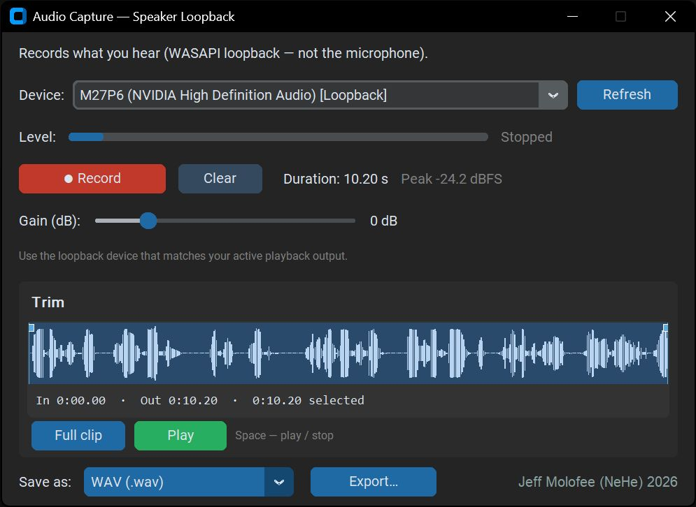

# Audio Capture (Speaker Loopback)



**2026 Jeff Molofee (NeHe)**

Records what your PC is actually playing through speakers or headphones — **not** what a microphone hears in the room.

## Why?

Recording “system audio” the usual way means pointing a mic at your speakers or enabling fragile workarounds like **Stereo Mix**. You pick up room noise, keyboard clicks, fan hum, and uneven levels.

This app uses Windows **WASAPI loopback**: a capture stream taken from your **playback device** (the same path Windows uses for output). You get a clean digital copy of browser tabs, games, calls, and music — with no microphone in the chain and no background sounds from your environment.

## Features

- **Speaker loopback capture** via [PyAudioWPatch](https://github.com/s0d3s/PyAudioWPatch) (WASAPI loopback devices)
- Live level meter while recording
- **Trim** start/end on an interactive timeline, then **preview** the selection (Space = play/stop)
- **Gain** adjustment (−6 to +24 dB) with peak readout
- Export trimmed audio: **WAV**, **OGG**, **OGA**, **FLAC**, **MP3**, **AIFF**, **AU** (via libsndfile / soundfile)

## What's New

### v1.0.0

- First public release.

## Requirements

- **Windows 10/11** (WASAPI loopback is Windows-specific)
- Python **3.11+** if building from source

## Usage

1. Pick the **loopback** device that matches your active playback output (names often include “loopback” or mirror your speakers/headphones).
2. Click **Record**, play audio on the PC, then **Stop**.
3. Drag the trim handles, preview with **Play** (or Space).
4. Choose a format and click **Export…**.

## Run from source

```powershell
cd Audio-Capture
python -m venv .venv
.\.venv\Scripts\Activate.ps1
pip install -r requirements.txt
python app.py
```

## Build standalone `.exe`

```powershell
.\build.ps1
```

Output: `dist\AudioCapture.exe`

Pre-built Windows builds are published on [GitHub Releases](https://github.com/NeHeGL/Audio-Capture/releases) (zip contains `AudioCapture.exe` and this README).

## How loopback differs from a microphone

| Approach | What you capture | Typical problems |
|----------|------------------|------------------|
| Microphone | Airborne sound in the room | Background noise, bleed, uneven level |
| Stereo Mix (legacy) | Mixed desktop audio (driver-dependent) | Often missing, disabled, or low quality |
| **WASAPI loopback** (this app) | Digital stream from the playback device | Windows only; pick the correct loopback device |

## License

MIT — see repository license if present; otherwise treat as open source for personal use.